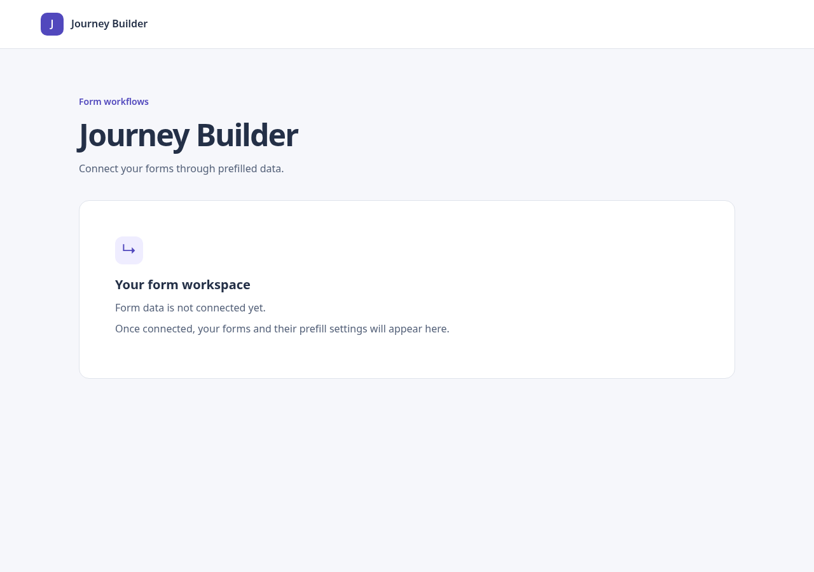

# Phase 1 — Independent project foundation

Status: Complete. Scope: application shell and development tooling only.

## Short explanation

Created a fresh React and TypeScript application with Vite, plain CSS, and a
minimal workspace. The page explains that form data is not connected yet.
Semantic landmarks, a named workspace region, and a keyboard skip link establish
an accessible starting point. No Claude application source was inspected or reused.

Strict TypeScript checks source, tests, and build configuration. Dependencies are
pinned to exact versions and recorded in the lockfile. Vitest uses jsdom with
React Testing Library, user-event, jest-dom, and cleanup after every test.
The project has no unnecessary graph or state-management dependencies.

## Files changed

- `package.json`, `package-lock.json`: exact dependencies and development/check scripts.
- `tsconfig.json`, `vite.config.ts`: strict checking, React transformation, and test setup.
- `.nvmrc`, `.gitignore`, `.env.example`: runtime version, generated-file exclusions,
  and public API settings reserved for Phase 2.
- `index.html`, `src/main.tsx`: HTML metadata and React StrictMode entry point.
- `src/app/App.tsx`, `src/index.css`: independent application shell and styling.
- `src/app/App.test.tsx`, `src/test/setup.ts`: behavior tests and DOM test isolation.
- `README.md`: install, run, test, build, structure, configuration, and limitations.
- `docs/implementation-plan.md`: Phase 1 status and next step updated.
- `docs/phase-01-foundation.md`: this explanation and validation record.
- `docs/evidence/phase-01-desktop.png`: real browser screenshot reviewed for layout.

`node_modules/` and `dist/` were generated locally and are ignored by Git.
No repository was published and no commit was created.

## Test coverage

The four tests cover the complete observable scope of this static shell:

1. The page exposes header/main landmarks and one primary heading.
2. The named workspace accurately explains its unconnected state and future contents.
3. The first keyboard stop is a skip link targeting the focusable main content.
4. React StrictMode renders one workspace and one main landmark.

These are behavioral assertions, not snapshots or CSS implementation assertions.
jsdom does not validate CSS layout or native fragment-focus navigation. Future
API, traversal, provider, mapping, and dialog tests belong to their implementation
phases; they are not represented by placeholder tests here.

## Validation evidence

Environment: Node.js 22.22.2, npm 10.9.7. Installed versions include React 19.3.0,
TypeScript 7.0.2, Vite 8.3.4, and Vitest 5.0.4.

| Check | Result |
| --- | --- |
| `npm ci` | Passed using the new lockfile; audit reported zero vulnerabilities at execution time |
| `npm run typecheck` | Passed |
| `npm run test:run` | Passed: one test file, four tests |
| `npm run build` | Passed: HTML, CSS, and JavaScript emitted to `dist/` |
| `npm run dev` | Started at http://127.0.0.1:5173 |
| HTTP request to the dev server | Returned the application HTML and Vite module entry |
| Headless Chrome DOM check | Confirmed React-rendered heading, workspace message, and main landmark |
| Desktop screenshot | Captured at 1280×900 and visually reviewed |

The connected browser tool could not launch because no display server was
available; the installed Chrome was used in headless mode instead. This is a
rendering smoke check, not a full end-to-end or accessibility audit. The dev server
reported another wildcard listener on port 5173 but successfully bound 127.0.0.1;
use the explicit local URL, or override the port if needed.

Tooling setup references: [Vite guide](https://vite.dev/guide/) and
[Vitest guide](https://vitest.dev/guide/). The local commands above are the evidence
for this project's compatibility and behavior.

## Remaining risks and deferrals

- No real API integration, mock server, forms, mappings, or data persistence yet.
- `.env.example` documents future public settings; Phase 1 does not consume them.
- Full keyboard activation, mobile/device review, provider configuration, and
  browser automation arrive with the corresponding interaction phases.
- Production output builds successfully; deployment and production browser checks
  have not been performed.
- Dependency vulnerability results reflect this installation only.

## Next phase

Phase 2 connects the official mock API: record its revision, configure endpoint
settings, add fetch cancellation and response/error handling, and prove a real
browser request. Add client tests for success, HTTP errors, malformed JSON, and
cancellation. Do not add traversal or mapping behavior until its planned phase.
