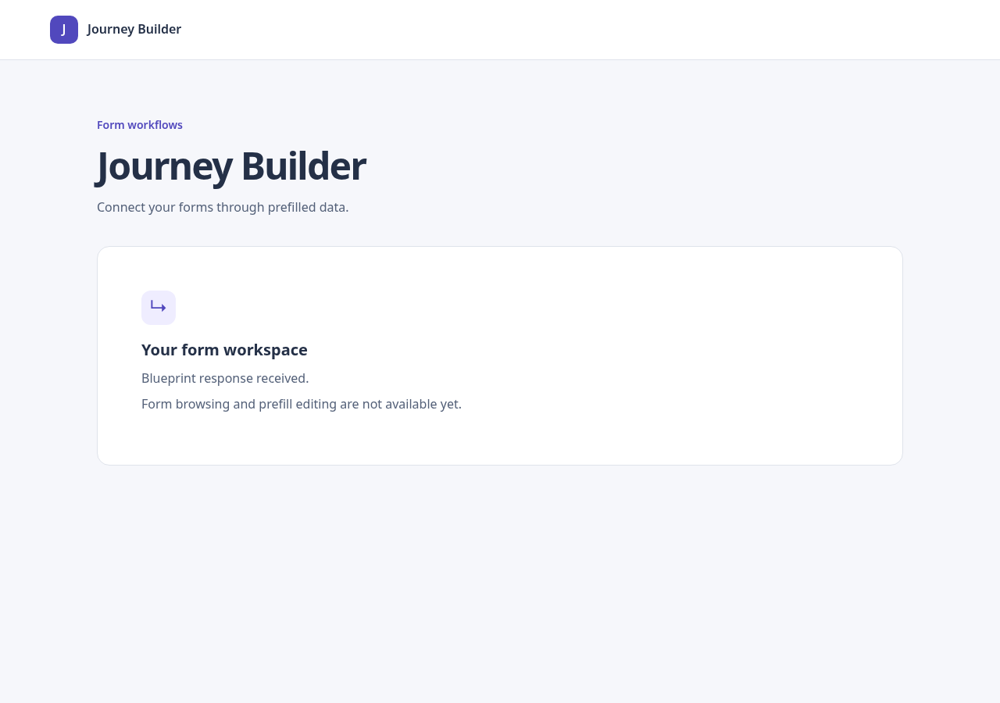

# Phase 2 — Connect to the mock API

Status: Implementation and local validation complete. No merge or deployment implied.

## Short explanation

The application now fetches the configured blueprint endpoint on mount and shows
loading, response received, or an actionable error. A retry button starts a fresh
request. Configuration is separate from transport, and the React hook owns request
lifetime. The view does not interpret graph fields: the client returns `unknown`
until Phase 3 validates and normalizes the response.

Each effect owns an AbortController. Unmount, endpoint changes, retry, and React
StrictMode cleanup cancel prior work. Both signal checks and result identity prevent
late success or failure from replacing the current state. Changes in configuration
hide old data immediately. No new dependencies were needed.

## Files changed

- `src/blueprint/config.ts` and tests: defaults, URL construction, identifier encoding,
  and public configuration errors.
- `src/blueprint/client.ts` and tests: fetch, HTTP status handling, JSON decoding,
  network recovery messages, and cancellation before/during a request or body read.
- `src/blueprint/useBlueprint.ts` and tests: loading/success/error state, retry,
  endpoint changes, stale result protection, unmount, and StrictMode cleanup.
- `src/blueprint/BlueprintConnection.tsx`: accessible status/error feedback and retry.
- `src/app/App.tsx`, `src/app/App.test.tsx`, `src/index.css`: connect the workspace,
  retain shell accessibility, and style the retry action.
- `src/vite-env.d.ts`, `.env.example`: typed, documented public settings.
- `README.md`, `docs/implementation-plan.md`, this document: setup, scope, and evidence.
- `docs/evidence/phase-02-connected.png`: actual connected browser screenshot.

## Decisions and boundaries

The default URL is `http://localhost:3000`, tenant `1`, and blueprint
`bp_01jk766tckfwx84xjcxazggzyc`. Values can be overridden through Vite environment
settings. URL prefixes are supported and identifier segments are encoded.
Explicit empty or ambiguous values produce a configuration error rather than
silently reverting to defaults. Public settings must never contain secrets.

Success means HTTP success and readable JSON. It does not prove graph validity.
All JSON values remain unknown until the next phase; this prevents misleading
TypeScript casts. HTTP errors do not render arbitrary server response bodies.
The client makes GET requests only; there is no server mapping-write integration.

## Validation evidence

| Check | Result |
| --- | --- |
| `npm run typecheck` | Passed |
| `npm run test:run` | Passed: 42 tests across four files |
| `npm run build` | Passed |
| `git diff --check` | Passed before handoff |
| Direct HTTP request | Response byte-matched the pinned mock fixture |
| Headless Chrome, mock running | App displayed “Blueprint response received.” after its real request |
| Headless Chrome, mock stopped | App displayed connection error, alert role, and retry button |
| Screenshot | Captured and visually reviewed at 1280×900 |

Tests cover default and overridden configuration, malformed URLs, encoded identifiers,
HTTP 400/401/404/500/503, unreadable JSON, network failures, abort before fetching,
abort during fetch/body decoding, loading/success transitions, retry recovery,
stale success/failure after endpoint changes, unmount, disabled configuration,
StrictMode, semantic landmarks, skip-link keyboard focus, and keyboard retry.
The hook tests deliberately resolve or reject abandoned promises to verify race handling.

The official [mock server](https://github.com/mosaic-avantos/frontendchallengeserver)
was cloned separately at revision `fdfbb9c78eb8ac518f952be183a3718098005265`.
Its response route is `GET /api/v1/{tenant}/actions/blueprints/{blueprint}/graph`.
Port 3000 was already occupied, so this verification changed only the isolated
mock's listen/log port to 3002. The fixture and route logic were unchanged.
The app used `VITE_API_BASE_URL=http://127.0.0.1:3002 npm run dev -- --port 5174`.
Only servers launched for this verification were stopped afterward.

The linked API documentation was retried but remains inaccessible. The mock is the
verified contract for this increment. Implementation references:
[React effect cleanup](https://react.dev/reference/react/useEffect) and
[Fetch responses and cancellation](https://developer.mozilla.org/en-US/docs/Web/API/Fetch_API/Using_Fetch).

## Remaining risks and deferrals

- Schema validation, graph normalization, field listing, and dependency checks await Phase 3/4.
- No timeout or automatic retry policy; a pending request remains pending until cancelled.
- Browser rendering and connection failures were verified; keyboard retry is covered
  by DOM interaction tests, not an automated real-browser click scenario.
- CORS/network failures appear as connection errors because browsers do not expose
  enough details to distinguish them reliably.
- No CI, deployment, backend persistence, or provider authentication proof is claimed.
- Mock data does not document a nonempty mapping serialization contract.

## Next phase

Phase 3 validates and normalizes the graph response, joins form nodes to definitions,
extracts fields, and renders a selectable form list. Test reused definitions, missing
definitions, empty graphs, arrays/objects, and the button exclusion policy. Keep
mapping edits and dependency traversal in their later phases.
