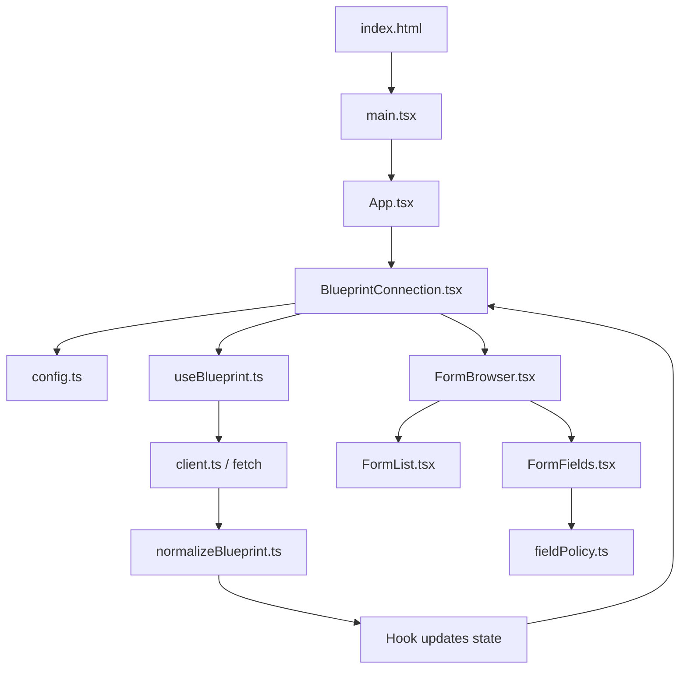
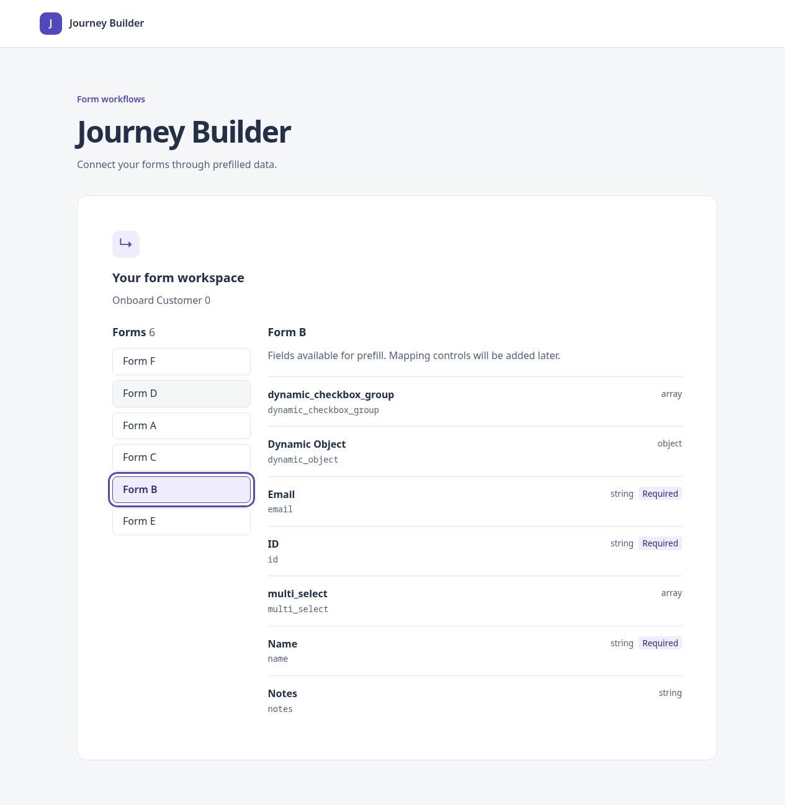
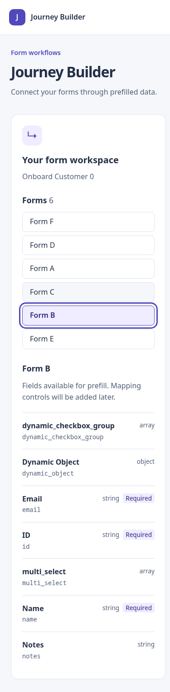

# Phase 3 — Validate, normalize, and browse forms

Status: Implementation and local validation complete. This does not imply merge,
CI, deployment, or publication. Work is on `feat/phase-03-form-browser`.

## Files changed

- `src/blueprint/model.ts`: readonly application types for blueprint, form instance, and field.
- `src/blueprint/normalizeBlueprint.ts`: runtime response checks and node/definition join.
- `src/blueprint/fieldPolicy.ts`: single rule excluding button controls from prefill targets.
- `src/blueprint/useBlueprint.ts`: normalize before publishing a successful request state.
- `src/blueprint/BlueprintConnection.tsx`: render the browser on success.
- `src/blueprint/client.ts`: update its boundary comment; HTTP behavior stays separate.
- `src/ui/FormBrowser.tsx`: selected-node state and empty blueprint feedback.
- `src/ui/FormList.tsx`: accessible form-selection buttons keyed by node ID.
- `src/ui/FormFields.tsx`: selected form's labels, keys, types, required markers, and empty state.
- `src/index.css`: list/detail layout, selected-button styling, and narrow-screen layout.
- `src/test/blueprintFixture.ts`: independently authored fixture with reused definitions.
- `src/blueprint/normalizeBlueprint.test.ts`, `fieldPolicy.test.ts`, and
  `src/ui/FormBrowser.test.tsx`: new validation and user-behavior tests.
- `src/blueprint/useBlueprint.test.tsx`, `src/app/App.test.tsx`: updated integration tests.
- `README.md`, `docs/implementation-plan.md`, this document, and evidence screenshots.

Debug logging is not part of this phase. No Claude application source was used.

## Short explanation of what is done

After fetching, the app validates the properties needed for form browsing and
normalizes the response into a small model. It joins each node's `component_id`
to a form definition's `id`, while preserving the node ID and node name as the
identity and label of the selectable instance.

The first form is selected initially. Selecting another form displays its fields
without another request. Field rows show friendly labels plus raw keys, types,
and required markers. Array and object fields remain visible; button controls
are excluded by the shared field-policy function. Empty blueprints and forms
without eligible fields have explicit messages. Invalid responses use the same
error-and-retry flow as network errors, with no partial form list.

## Learning React: architecture and file structure

```text
index.html
src/
  main.tsx                       Starts React and imports CSS
  app/App.tsx                    Page shell
  blueprint/
    config.ts                    Builds the endpoint
    client.ts                    Fetches unknown JSON
    model.ts                     Describes normalized data with TypeScript
    normalizeBlueprint.ts        Checks actual data and transforms it
    fieldPolicy.ts               Decides which fields can be prefill targets
    useBlueprint.ts              Owns request state and effect cleanup
    BlueprintConnection.tsx      Chooses loading/error/success UI
  ui/
    FormBrowser.tsx              Owns selected node ID
    FormList.tsx                 Displays choices and reports clicks
    FormFields.tsx               Displays fields for the selected instance
  test/
    blueprintFixture.ts          Example data used by tests only
    setup.ts                     Test matchers and cleanup
```

A component is a function describing UI with JSX. A `.tsx` file can contain JSX;
`.ts` files hold ordinary TypeScript. A custom hook, like `useBlueprint`, combines
React's hooks into reusable behavior. Pure functions, like `normalizeBlueprint`,
need no React at all and are tested directly.

There are two kinds of state here. `useBlueprint` remembers the request result;
`FormBrowser` remembers which node the user selected. Keeping these separate means
choosing a form does not restart the request or change the fetched data.

### What loads first and which file calls another

1. `npm run dev` starts Vite, which reads `vite.config.ts` and serves the app.
2. The browser opens `index.html`. Its script points to `src/main.tsx`, and its
   empty `div#root` is the container React will manage.
3. `main.tsx` imports `App` and `index.css`, then calls `createRoot(...).render()`.
4. React renders `App`, whose JSX contains `<BlueprintConnection />`.
5. `BlueprintConnection` calls `readEndpoint()` and the custom `useBlueprint()` hook.
6. The hook initially returns loading. After React commits the render, its effect
   calls `fetchBlueprint()` in `client.ts`.
7. The client receives and parses JSON. `normalizeBlueprint()` checks it and builds
   the model. The hook then stores success or an error using its state setter.
8. Updating state makes React render `BlueprintConnection` again. Success now
   renders `<FormBrowser blueprint={state.data} />`.
9. `FormBrowser` passes data and a selection callback to `FormList`, and passes the
   selected form to `FormFields`.



This is the execution/data flow, not a promise that files download in exactly
this order. JavaScript imports load dependencies before module code executes.
TypeScript types disappear during compilation; they do not inspect server data.
That is why runtime checks in `normalizeBlueprint` are necessary even with
`model.ts` and strict TypeScript.

### What happens when you click Form B

`FormBrowser` contains:

```tsx
const [selectedId, setSelectedId] = useState<string | null>(null);
const selected = blueprint.forms.find((form) => form.nodeId === selectedId)
  ?? blueprint.forms[0];
```

`selectedId` is remembered between renders. `selected` is derived from the current
data rather than copied into another state variable. When nothing is selected,
or a selected node disappears, the first available form is used.

`FormList` receives `onSelect={setSelectedId}` as a prop. A prop is an input a
parent component passes to a child. Clicking its button calls
`onSelect(form.nodeId)`. The setter changes state, React renders `FormBrowser`
again, and the new selected form is passed to `FormFields`. React updates the
relevant DOM; there is no page reload or extra API request.

Buttons use `aria-pressed` to expose selection and keep native keyboard behavior.
Their React `key` is the node ID, so different instances sharing a definition
remain distinct. The browser component itself is keyed by blueprint ID, resetting
local selection when a different blueprint arrives. These keys are React identity
hints, not ordinary props received by the child.

`FormFields` filters with `isPrefillField()` and uses `.map()` to create a row for
each field. The field key identifies each row. React renders labels as text, so
server strings containing HTML are not interpreted as executable markup.

## Validation decisions

- Required response structure: a nonempty blueprint ID and nodes/forms/edges arrays.
- Nodes require IDs and types. Form nodes require a name and a definition reference.
- Duplicate node or definition IDs are rejected because they make identity ambiguous.
- All provided definitions require field-schema properties objects. Each property
  must be an object; optional labels, type metadata, control metadata, and required
  lists are checked before use.
- Missing or blank field titles fall back to the raw property key. Missing type
  metadata displays “Unspecified type”; valid union types are displayed together.
- Definition names never replace instance names. Instances preserve API order;
  fields preserve schema property order. UI-schema layout order is not interpreted.
- Non-form nodes and edge/prerequisite data are retained for later graph analysis,
  but non-form nodes are not selectable forms.
- This is validation of the browsing contract, not a complete JSON Schema validator.
  Nested object/array constraints, boolean schemas, `$ref` resolution, `ui_schema`,
  and dynamic endpoint execution are not implemented. Button classification uses
  `avantos_type: "button"`, matching the verified fixture.
- Cycles, dangling edge references, and edge/prerequisite agreement belong to Phase 4.
  Being able to browse a blueprint does not yet establish valid dependency semantics.

## Validation evidence

| Check | Result |
| --- | --- |
| `npm run typecheck` | Passed |
| `npm run test:run` | Passed: 96 tests across seven files |
| `npm run build` | Passed |
| `git diff --check` | Passed |
| Headless Chrome against official mock | Six distinct form nodes, seven visible fields in shared definition |
| Mouse selection | Form D selected independently from Form F despite shared definition |
| Native keyboard events | Tab and Enter selected Form B and updated its fields |
| Responsive layout | No horizontal overflow at 1280×1000 and 390×844 |
| Screenshots | Desktop and narrow viewport captured for review |

New tests cover reused definitions, labels/keys/types, required fields, non-mutation,
empty graphs, non-form nodes, empty fields, union and unspecified types, literal
prototype-like IDs/dotted keys, 27 malformed-response cases, button policy,
keyboard selection, duplicate names, selected-node removal, and text escaping.
Updated hook and App tests cover validation failure followed by successful retry
and preserve the earlier cancellation, stale-response, and StrictMode coverage.

The isolated official mock is revision `fdfbb9c78eb8ac518f952be183a3718098005265`.
Verification used its existing temporary port-only modification (3002) and
`VITE_API_BASE_URL=http://127.0.0.1:3002 npm run dev -- --port 5174`.
The first Chrome automation attempt omitted Enter's character event; rerunning
with a complete native key sequence passed without application changes.
This is headless Chrome viewport evidence, not physical-device or screen-reader proof.





## Remaining risks and deferrals

No graph traversal, source providers, mappings, persistence, API write operations,
full JSON Schema evaluation, or dependency-validity guarantee is included.
No new dependencies were added. Local debug edits are excluded from the phase commit.
Merge, CI, and deployment remain separate from the local validation recorded here.

## Next phase

Phase 4 builds the predecessor index and ancestor queries, checks cycles and
missing endpoints, compares edges with prerequisites, and tests direct/indirect
classification and deduplication. UI provider selection remains in later phases.
