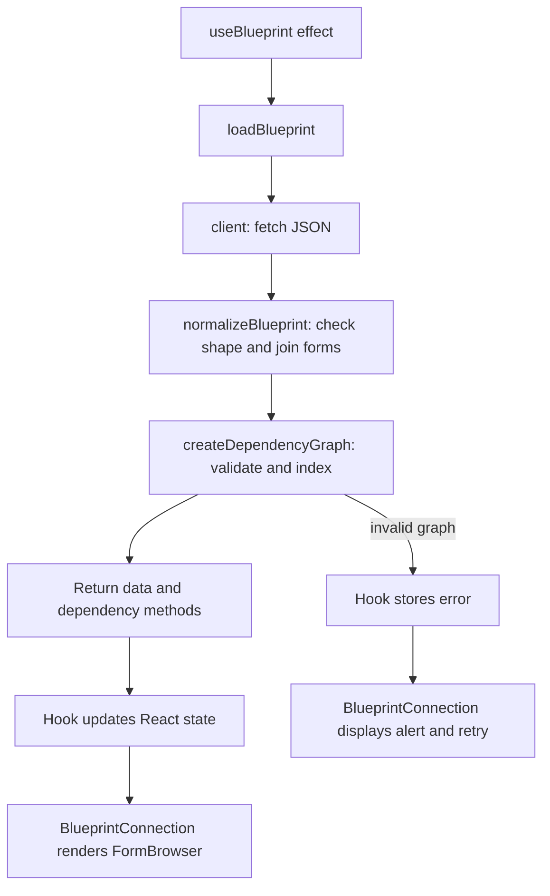
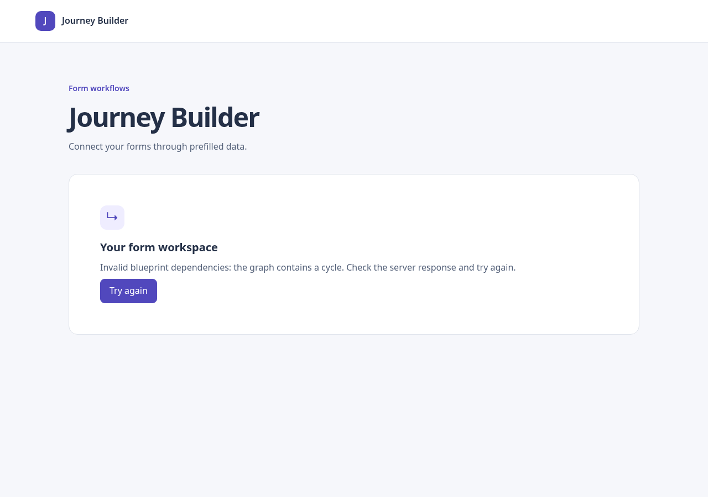

# Phase 4 — Validate dependencies and query upstream forms

Status: Implemented and locally validated. Merge, CI, and deployment are separate.
Branch: `feat/phase-04-dependencies`, based on main after Phase 3 PR #2 was merged.

## Files changed

- `src/dependencies/createDependencyGraph.ts`: graph validation, private predecessor
  index, cycle detection, ancestor queries, and form-source projection.
- `src/dependencies/createDependencyGraph.test.ts`: topology, integrity, ordering,
  long-chain, and exhaustive small-DAG tests.
- `src/blueprint/loadBlueprint.ts`: fetch → normalize → validate/index orchestration.
- `src/blueprint/loadBlueprint.test.ts`: pipeline success, rejection, and cancellation.
- `src/blueprint/useBlueprint.ts`: invokes the loader and retains its dependency object.
- `src/blueprint/useBlueprint.test.tsx`: dependency-object reuse and existing request regressions.
- `src/blueprint/normalizeBlueprint.ts`: updated comment describing its boundary.
- `src/app/App.test.tsx`: dependency errors block browsing and recover on retry.
- `src/test/dependencyFixture.ts`: independently authored graph fixture builder.
- `README.md`, `docs/implementation-plan.md`, this phase document, and an error screenshot.

The local endpoint debug statement in `client.ts` is preserved but excluded from
this phase's commit and PR. No Claude application source was used.

## Short explanation of what is done

The app now checks dependency semantics before displaying a blueprint. It rejects
cycles, missing referenced nodes, contradictory prerequisites, and ambiguous IDs.
Valid data gains a reusable dependency query object, ready for the source providers
in Phase 5. This phase does not add a source picker or mapping controls.

For A → B → D, D has B as a direct predecessor and A as an indirect ancestor.
A direct predecessor is connected by one incoming edge. An ancestor can be reached
by following one or more incoming edges backward. The indirect group excludes
all direct predecessors, even if a direct predecessor also has a longer path.

For the challenge graph:

| Target | Direct forms | Indirect forms |
| --- | --- | --- |
| A | none | none |
| D | B | A |
| F | D, E | A, B, C |

Repeated paths do not repeat a source. Self, descendants, siblings, and disconnected
nodes are excluded. Distinct nodes that share a form definition remain distinct.

## Learning React: architecture and responsibilities

```text
src/
  blueprint/
    model.ts                     Existing plain data types; unchanged
    client.ts                    Existing HTTP/JSON transport
    normalizeBlueprint.ts        Existing structural validation
    loadBlueprint.ts             NEW: coordinates the complete loading pipeline
    useBlueprint.ts              CHANGED: stores data plus dependency queries
    BlueprintConnection.tsx      Existing loading/error/success rendering
  dependencies/
    createDependencyGraph.ts     NEW: pure graph logic; no React imports
    createDependencyGraph.test.ts
  ui/
    FormBrowser.tsx               Existing selected-node state
    FormList.tsx                  Existing form buttons
    FormFields.tsx                Existing field detail view
  test/
    dependencyFixture.ts         NEW: small graphs for tests
```

### What changed from Phase 3

Phase 3 checked that a response had usable nodes, definitions, and fields, then
made those forms browsable. It did not establish whether the edges described a
valid DAG or agreed with prerequisites.

Phase 4 adds the next check. The browser still renders forms using the same
components. An invalid graph now takes the existing error branch rather than the
success branch. The new graph module is plain TypeScript, so its algorithms can
be tested without rendering React or calling the network.

`model.ts` still describes plain normalized data. `LoadedBlueprint`, defined in
`loadBlueprint.ts`, describes the loader's result:

```ts
interface LoadedBlueprint {
  readonly data: Blueprint;
  readonly dependencies: DependencyGraph;
}
```

`data` is what the existing form browser displays. `dependencies` contains methods
that future source providers can call. It is an in-memory helper object, not JSON
received from the server and not a persistence format.

### Loading and rendering order

Startup remains `index.html` → `main.tsx` → `App.tsx` → `BlueprintConnection.tsx`.
The connection component builds the endpoint and calls `useBlueprint()`.

After React commits the initial loading view, the hook's effect calls
`loadBlueprint(endpoint, signal)`. The loader performs these steps:



The hook stores success with `{ status: "success", ...loaded }`. The `...loaded`
syntax copies the loader result's properties into that state object. In the type
`{ status: "success" } & LoadedBlueprint`, `&` means the success value has both
sets of properties: the status plus data and dependency methods.

A state update causes React to render the connection component again. No new
component needs to know how cycle detection works. Clicking a form still changes
only selection state in `FormBrowser`; it does not fetch or rebuild the graph.

### How the graph module works

A `Map` connects each node ID to a `Set` of incoming node IDs. A Set prevents the
same edge from adding the same parent twice. The index is constructed once for
each successfully loaded response and kept in the hook's success state. Its maps
stay private inside a closure: only the query methods are returned to callers.

Cycle detection uses Kahn's algorithm: start with nodes having no predecessors,
then remove their outgoing dependencies and process newly available nodes. If
not every node can be processed, the graph contains a cycle. It checks every
component, including disconnected components, without recursive calls.

`getAncestors(nodeId)` walks backward with a stack and a visited Set. The visited
Set stops repeated paths from returning a node more than once. This walk is also
iterative, so a long chain does not overflow the JavaScript call stack.

`getUpstreamForms(nodeId)` uses that result, drops non-form nodes from the returned
options, and sorts forms by name then node ID. Non-form nodes remain part of the
traversal: for A → action → D, A is an indirect form source for D.

```ts
const loaded = await loadBlueprint(endpoint, signal);
const groups = loaded.dependencies.getUpstreamForms(targetNodeId);
// groups.direct and groups.indirect contain FormInstance objects.
```

This is the future provider integration point, not a new UI feature in this phase.

## Validation and ordering policy

- Edges are authoritative. `prerequisites: null` in the normalized model means the
  API omitted that metadata, so comparison is skipped. An explicit empty array
  claims no predecessors and must agree with the edges.
- Supplied prerequisites must reference existing nodes and equal the incoming
  edge set. They are not silently merged with contradictory edges.
- Duplicate edges and repeated prerequisite entries are treated as the same
  relationship. Duplicate node IDs or duplicate form projections are rejected.
- Missing edge endpoints, missing prerequisite nodes, cycles, and invalid form
  projections reject the entire load before a form list is exposed.
- Unknown query targets throw an explicit error rather than silently returning no sources.
- Ancestor IDs use deterministic string ordering. Form results use deterministic
  name ordering with node ID as a tie-breaker; this is not locale-aware collation.
- Group objects and result arrays are frozen. Form metadata remains readonly at
  the TypeScript boundary; there is no claim of deep runtime freezing.
- The index is reused; transitive results are computed per query rather than caching
  all node pairs. Index construction is O(V + E + P), where P is prerequisite entries.
  Queries visit the reachable upstream subgraph and sort the resulting IDs/forms.

## Validation evidence

| Check | Result |
| --- | --- |
| `npm run typecheck` | Passed |
| `npm run test:run` | Passed: 137 tests across nine files |
| `npm run build` | Passed |
| Diff whitespace check | Passed |
| Official mock in headless Chrome | Six forms still render after validation |
| Temporary cycle injection | Error shown and form list hidden |
| Restore fixture and click Try again | Six forms returned and error disappeared |

Tests include roots, chains, branches, diamonds, disconnected nodes, self-loops,
short and disconnected cycles, duplicate IDs/relationships, missing references,
prerequisite disagreement, missing versus empty metadata, non-form intermediary
nodes, reused definitions, same-name sorting, prototype-like IDs, immutable query
arrays, blueprint isolation, and unknown targets. Integration tests cover error
propagation and retry while retaining cancellation and StrictMode regression tests.

One test checks every one of the 1,024 possible forward-edge DAGs on five nodes
against an independent matrix transitive-closure calculation. Another exercises
a 12,000-node chain to catch recursive stack-overflow problems. These are bounded
correctness checks, not production capacity benchmarks.

Browser verification used official mock revision
`fdfbb9c78eb8ac518f952be183a3718098005265`, with the isolated server's listen port
set to 3002 and the app on 5174. The cycle test temporarily changed only that
isolated fixture, then restored the original bytes in a `finally` block. The
first browser script needed navigation synchronization; the synchronized rerun
passed. The screenshot below is from the deliberately invalid fixture.



## Remaining risks and deferrals

No provider registry, configuration of source combinations, source picker, mapping
state, persistence, or full JSON Schema interpreter is implemented here. Returned
forms are upstream candidates; field compatibility policies arrive separately.
The browser evidence is local headless Chrome, not deployment or physical-device
proof. No CI success or merge is implied by these local checks.

## Next phase

Phase 5 introduces a common source-provider contract and direct-form, indirect-form,
and global providers. Those providers will consume the dependency methods rather
than put traversal inside React components. Add provider and aggregation tests,
then implement runtime provider combinations in Phase 6.
