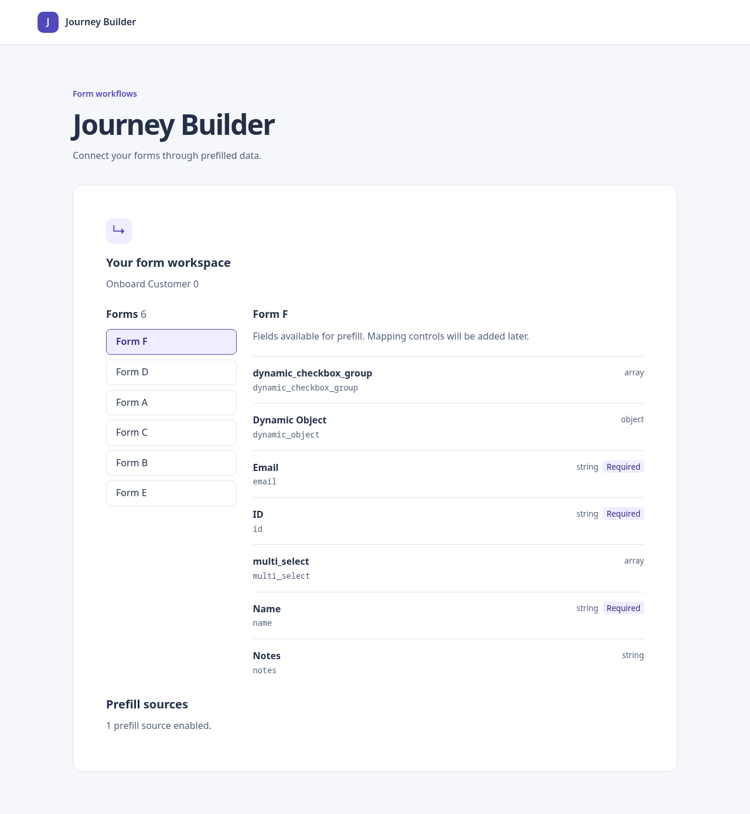
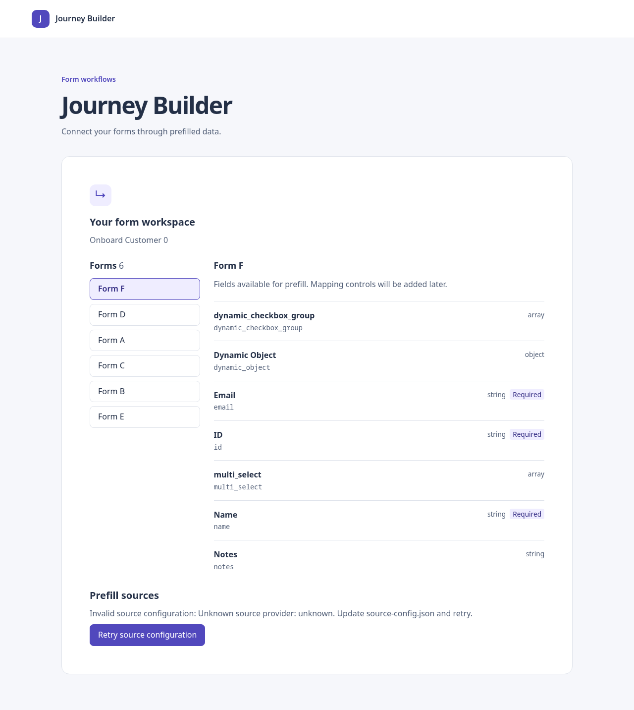

# Phase 6 — Runtime source configuration

## What is done and why

Existing source combinations can now be changed by editing a public JSON file and reloading the page, without editing TypeScript or rebuilding JavaScript. The app reports configuration loading, enabled source count, an empty selection, or a retryable error. It never silently enables default providers after invalid configuration.

Phase 5 PR #4 was still open when this phase started. This branch and PR are stacked on `feat/phase-05-sources`; they do not merge the previous phase automatically.

## File structure and architecture for React learners

```text
public/source-config.json                  deployed runtime data
src/sources/configuration.ts               fetch and validate unknown JSON
src/sources/useSourceConfiguration.ts      connect asynchronous work to React state
src/sources/SourceConfigurationStatus.tsx  display loading/success/error and Retry
src/sources/model.ts                       optional provider settings validator
src/sources/providers/                     built-in settings validators
src/app/App.tsx                            compose the new status component
```

Each layer has a different job:

1. The JSON file is data, not compiled application code. Vite copies it into the built output. In development edit `public/source-config.json`; after building edit the served `dist/source-config.json` (or its hosting equivalent). Editing `public/` after a build does not update an already-deployed copy.
2. `configuration.ts` fetches this file using the Vite base path and `cache: "no-store"`. It accepts an unknown JSON value, checks its shape, resolves registered providers, validates settings, and returns only enabled selections in configured order. Missing files, invalid JSON, and network errors receive distinct messages.
3. `useSourceConfiguration.ts` is a custom React hook. It uses `useState` to hold results and a retry counter. `useEffect` starts the request after rendering; its cleanup aborts the request. Results from old requests cannot replace current state. Changing the URL or retrying hides prior selections immediately while the new request loads.
4. `SourceConfigurationStatus.tsx` is the view. It reads the hook state and renders a status paragraph, count, empty message, or alert and Retry button. It does not parse JSON or know which providers exist.
5. `App.tsx` places the component beside the existing blueprint browser. Blueprint failures and configuration failures remain independent. Forms are still browsable when configuration is invalid; mapping controls do not exist yet.

## What loads first?

```text
index.html → src/main.tsx → App
  ├── BlueprintConnection → existing blueprint loader → form browser
  └── SourceConfigurationStatus
        → useSourceConfiguration
          → loadSourceConfiguration → fetch source-config.json
          → parseSourceConfiguration → registry → settings validators
        → state update → React renders count or error
```

React initially renders the loading message. When the Promise settles, the hook updates state and React renders again. Retry increments a counter, which causes the effect to run again; it does not reload the entire page.

The selections returned by the hook match Phase 5's `loadSourceCatalog` input. Tests connect configuration parsing to the real aggregator for all eight combinations. The status view currently consumes the count only. Connecting this state to a field dialog remains Phase 8; no source-option picker is claimed in this phase.

## Configuration contract

```json
{
  "providers": [
    { "id": "direct-forms", "enabled": true },
    { "id": "indirect-forms", "enabled": false },
    { "id": "global-properties", "enabled": true }
  ]
}
```

- Listed IDs must be installed and unique, including disabled entries.
- Each entry needs a boolean `enabled`; unknown keys are rejected to catch typos.
- Omitted providers are disabled. `{"providers": []}` is valid.
- Enabled entries retain their configured order.
- Built-ins accept no `settings`. A new provider that supports settings implements `validateSettings(settings: unknown)`; configuration calls it for enabled and disabled entries. A provider without a validator may be configured only without settings. This addition is optional for existing providers.
- Provider `getGroups` still owns validation for direct callers outside the configuration loader.
- The file is public. Do not put credentials or secrets in it.
- Changes apply on reload or configuration retry. There is no polling or live file watcher in production.

Changing combinations of installed providers needs no build. Adding a genuinely new provider still requires implementation, registration, tests, and a build.

## Tests and validation evidence

- `npm run test:run`: **219 tests passed in 13 files**, 46 more tests than Phase 5.
- `npm run typecheck`: passed.
- `npm run build`: passed.
- `git diff --check`: passed.
- Parser/catalog tests exercise all eight subsets and assert actual direct/indirect/global group IDs, ordering, empty configuration, malformed shapes and flags, extra keys, unknown and duplicate IDs, disabled-entry validation, built-in settings rejection, and custom settings validators.
- HTTP tests cover deployment base paths, uncached reloads, HTTP failures, invalid JSON/HTML fallback, network failure, and cancellation.
- Hook tests cover loading, failure/retry, stale success/error, hiding old selections, unmount cleanup, and StrictMode.
- App integration tests use the real configuration component alongside the real form browser. Older blueprint-focused App tests isolate that separately tested component to preserve their request-specific assertions.

### Production-build browser check

Headless Chrome served a disposable copy of `dist` over local HTTP. Configuration requests were real HTTP requests; blueprint requests were intercepted with the previously pinned mock fixture. This is not a live mock-server integration claim.

1. Default deployed file displayed three enabled sources.
2. Editing only deployed JSON and reloading displayed one enabled source.
3. An unknown provider displayed an actionable error.
4. Replacing the file with an empty list and clicking Retry displayed no enabled sources.
5. The JavaScript asset SHA-256 was unchanged throughout; no rebuild occurred and no page errors were recorded.

Browser execution: `node /tmp/phase06-browser.cjs` (temporary local harness using already-installed Playwright and Chrome; not a portable repository test command).




## Remaining risks and deferrals

No mapping state, source dialog, persistence, remote provider, or evaluated values are added. The browser demonstrates configuration status; actual catalog group changes are verified in automated integration tests. Provider-level settings validation is extensible, but built-ins expose no configurable settings yet. Future dialog composition must share the validated selections and block catalog requests on configuration failure. Hosting must serve the JSON separately from SPA fallbacks and avoid stale intermediary caching; deployment was not performed. CI and merge are separate from local validation.

## Next phase

Phase 7: immutable mapping actions to set, replace, and clear source references, isolated by blueprint, form node, and field. Mapping state remains in memory and will be documented as resetting on reload.
