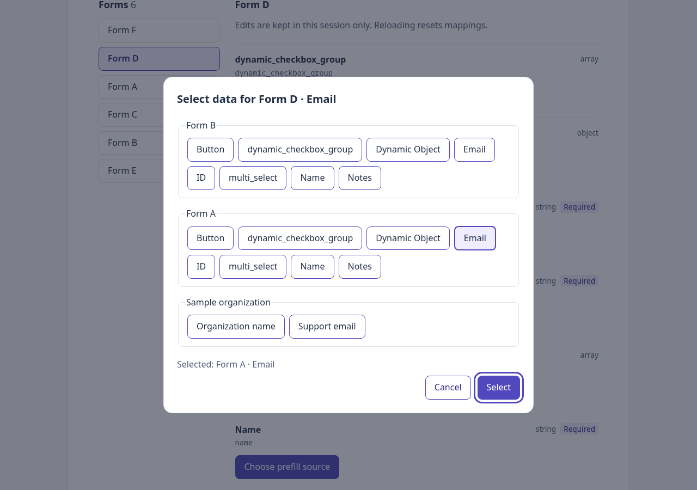
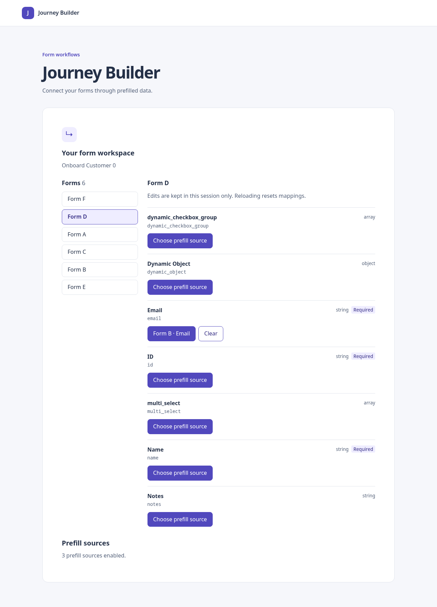
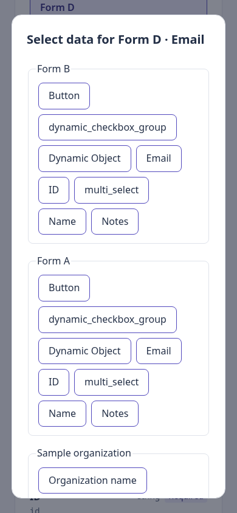

# Phase 8 — Basic source-selection flow

## Outcome

Users can now open a field, choose an upstream or global source, preview their choice, and confirm a mapping. They can replace or clear it, navigate between forms without losing edits, and cancel a draft without changing existing mappings. Mappings remain in memory; the editor says that reloading resets them.

PR #6 was merged before this phase started. This branch starts from `main` at `3a88d59`; it does not require another feature branch.

## Architecture for someone learning React

```text
src/app/App.tsx                         owns the shared source configuration request
src/blueprint/BlueprintConnection.tsx   loads and validates the blueprint
src/ui/PrefillEditor.tsx                owns mapping state and the active target
src/ui/FormBrowser.tsx                  owns selected-form navigation
src/ui/FormFields.tsx                   renders field metadata and supplied controls
src/ui/SourceDialog.tsx                 loads sources and owns a temporary draft
src/sources/SourceConfigurationStatus.tsx displays the shared configuration state
src/ui/PrefillEditor.test.tsx           interaction and lifecycle tests
src/index.css                          mapping buttons and responsive dialog styles
```

The existing graph, provider, configuration, and reducer services are reused. No UI dependency was added.

### What loads first?

```text
index.html → src/main.tsx → App
  ├── useSourceConfiguration → runtime JSON → validated selections
  ├── SourceConfigurationStatus receives that same configuration state
  └── BlueprintConnection → useBlueprint → loadBlueprint
        → fetch → normalizeBlueprint → createDependencyGraph
        → PrefillEditor
          ├── usePrefillMappings → mapping reducer
          ├── FormBrowser → FormFields → mapping buttons
          └── SourceDialog (only while a field is open)
                → loadSourceCatalog → selected registered providers
```

`App` now calls the configuration hook once and passes its result down as props. Previously the status component owned the request. Lifting it makes the status display and editor agree about which providers are enabled. Failed or loading configuration disables assignment/replacement; existing mappings can still be cleared. Empty configuration is valid and produces a dialog with no available sources.

`BlueprintConnection` passes the normalized blueprint and its already-built dependency index into the editor. The index is not rebuilt for every field or modal render.

### Why state lives in different components

- `PrefillEditor` calls `usePrefillMappings` once, above the selected form. Switching forms changes what is displayed without unmounting the mapping owner.
- `FormBrowser` owns only selected-form navigation. Its optional `renderFields` callback is composition: the editor supplies richer field content without teaching the browser about providers or mappings. The existing standalone read-only browser remains supported.
- `FormFields` owns field metadata and target filtering. Its optional `renderControls` callback supplies mapping buttons beside each eligible field. Buttons remain excluded from targets while source providers can expose button outputs.
- `SourceDialog` owns a temporary selected reference key. Clicking an option updates this draft, not the saved mapping. Clicking Select resolves that key against the current successful catalog and calls `onConfirm`. Cancel, Escape, native dialog cancellation, or unmounting discard the draft.

A typical user action works like this:

```text
Click D.email → editor stores D + email as the active target
  → dialog mounts and loads sources
  → click A.email → dialog updates draft and preview
  → click Select → editor dispatches setMapping(D.email, A.email)
  → reducer returns new state → React renders the mapped row
```

Replacing uses the same set action. Clearing dispatches the clear action and returns focus to the remaining field button. The reducer still stores stable references only. The editor separately caches confirmed display labels by provider-namespaced source identity; this presentation cache is session-only and does not change mapping identity. Labels come from provider group/option output, so a custom provider resource ID cannot be mistaken for a form node.

## Dialog behavior and accessibility

The dialog uses native `<dialog>.showModal()`, which places it in the browser's modal top layer and makes the background inert. It has an accessible title containing the target form and field. Initial focus goes to Cancel, Tab/Shift+Tab stay within enabled dialog buttons, and dismissal restores focus to the opening field button when it still exists.

Each group is a fieldset with a legend. Options are buttons with `aria-pressed`; selection is previewed in a polite live region. Select stays disabled during loading, on failure with no options, for empty catalogs, and until a current option is selected. The dialog scrolls within the viewport on narrow screens. It does not implement a custom ARIA tree.

Provider calls receive an AbortSignal. Closing aborts work and ignores late results. A changed graph/configuration invalidates the active target and closes the dialog; returning to an old configuration does not resurrect its draft. A changed registry invalidates the previous catalog and selection. Basic loading, empty, and generic partial-error feedback is included so the first dialog is usable; richer provider-specific feedback remains Phase 9.

## Tests and validation

- `npm run test:run`: **273 tests passed across 16 files**, including **21 new editor interaction tests**.
- `npm run typecheck`: passed (also run by the build).
- `npm run build`: passed.
- `git diff --check`: passed.

New tests cover D.email from A, persistence across form navigation, replacement from B, clearing/focus, Cancel/Escape/native cancellation, replacement cancellation, Tab containment, root/global sources, empty configuration, configuration errors, configuration/graph/target changes, field isolation, remount reset, StrictMode, fourth-provider selection, late resolve/reject after cancellation, partial failures, lost source eligibility after registry changes, provider label collisions, and clearing while configuration is unavailable.

jsdom does not implement native dialog top-layer behavior; the interaction file supplies showModal/close shims. These tests verify application behavior, not browser inertness. Native behavior was checked separately below. Existing App tests now mock the shared configuration hook for blueprint-focused assertions; actual configuration-to-App integration tests remain active.

### Browser verification

Executed `node /tmp/phase08-browser.cjs`, a temporary local harness using existing Playwright and Chrome installations. It served the final built assets and a disposable copy of runtime configuration over local HTTP. Port 3000 was already occupied; a read-only check confirmed the existing listener returned the expected six-form mock graph with HTTP 200, and the test reused it without changing the process or fixture. Blueprint and configuration requests were real HTTP, with no interception.

Verified:

1. Open D.email with Cancel initially focused and Select disabled.
2. Select A.email; verify preview, Tab/Shift+Tab containment, and confirm with Enter.
3. Verify the mapped label and focus returned to the trigger.
4. Navigate to E and back; D retains its mapping.
5. Draft B.email then Escape; A.email remains saved.
6. Confirm B.email, then clear the mapping.
7. Open the dialog at 390 × 844; no horizontal page overflow and the dialog stays inside the viewport.
8. Change only the served configuration to an empty list, reload, and verify an empty dialog with Select disabled.
9. No page errors; both recorded graph requests returned HTTP 200.

The first harness attempt could not start another listener on occupied port 3000. A subsequent attempt corrected a raw `email` test selector to the normalized UI label `Email`. The final run passed. No unrelated listener was stopped.





## Files changed and cleanup

New: `PrefillEditor.tsx`, `SourceDialog.tsx`, the editor test file, this phase document, and three screenshots. Updated: app/configuration composition, BlueprintConnection, FormBrowser/FormFields, App tests, shared CSS, README, and implementation plan. Removed an existing FormBrowser debug console log while integrating that component. No package or lockfile changes.

## Remaining risks and deferrals

Phase 9 adds search, expansion, no-match feedback, provider-specific failure details, and unavailable-reference labels. Successful options remain usable with a generic partial-error notice today. Confirmed labels are snapshots; live label refresh and disabled-provider status are not implemented yet. Eligibility is checked against the current loaded catalog and target/configuration identity; there is no remote re-fetch at confirmation or real submitted-value evaluation.

Mapping state resets on editor unmount/reload, and no backend writes occur. Type compatibility/coercion is not inferred. The dialog assumes modern native-dialog support. Automated Chrome checks are not a screen-reader or cross-browser audit. The local browser harness is not a portable CI browser test command. CI, merge, and deployment are separate from these local results.

## Next phase

Phase 9 — searchable and expandable source groups, detailed provider failures, and unavailable mappings. The current cancellation/identity guards and fourth-provider UI test provide a starting point for broader stale-result and configuration-change scenarios.
