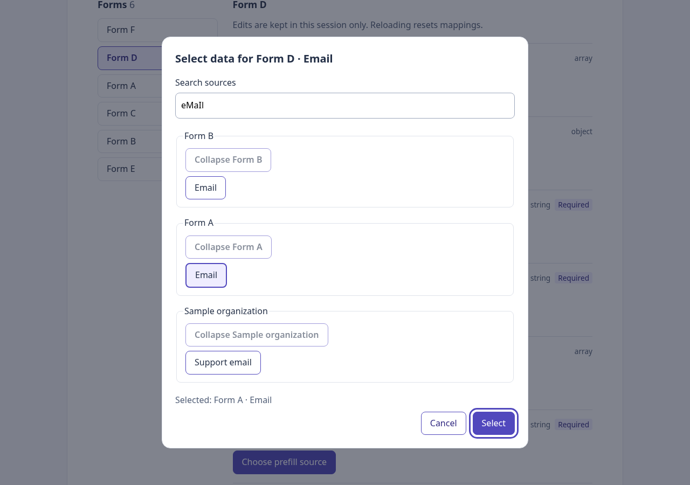
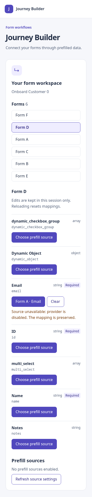
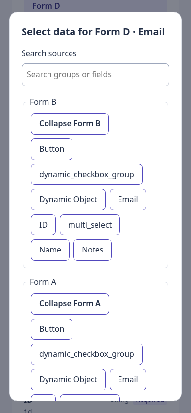

# Phase 9 — Search, failures, and unavailable mappings

## Outcome

The source dialog now searches group and field labels, expands/collapses groups, distinguishes empty catalogs from no search matches, and identifies failed providers with retry. Saved mappings display availability feedback when their provider is disabled, fails, or no longer offers the field. Such mappings remain intact and can be cleared or replaced.

A new **Refresh source settings** action applies deployed configuration changes without reloading the page and losing session mappings. Phase 8 PR #7 was merged before this branch started; this PR targets main.

## Architecture for React learners

```text
src/sources/useSourceCatalog.ts        shared asynchronous catalog lifecycle
src/sources/useSourceCatalog.test.tsx  stale-result and cancellation tests
src/ui/SourceDialog.tsx                dialog draft, search text, preview, retry
src/ui/SourceGroupChoices.tsx          one expandable, searchable option group
src/ui/MappingControls.tsx             field actions and saved-source availability
src/ui/PrefillEditor.tsx               stable contexts and saved mapping owner
src/sources/SourceConfigurationStatus.tsx  refresh settings without a page reload
```

### What loads first?

```text
index.html → main.tsx → App
  ├── useSourceConfiguration → validated runtime settings
  ├── SourceConfigurationStatus → refresh action
  └── BlueprintConnection → normalized blueprint + dependency index
       → PrefillEditor → FormBrowser → FormFields → MappingControls
            └── SourceDialog → useSourceCatalog → source providers
                    └── SourceGroupChoices
```

The entry sequence remains the same. What changes is how components reuse the catalog service and respond to changing data.

### useSourceCatalog — connect async work to React

Phase 8 loaded the catalog inside the dialog. This phase extracts that effect into a hook used by both the dialog and mapped field controls. It receives a context, selected providers, and registry. A null context means idle: no provider calls are started.

The hook tracks idle/loading/success/error and offers retry. Each stored result includes the exact input identities and request attempt. If inputs or the attempt change, old options disappear immediately, before the new effect runs. Effect cleanup aborts old work, and completion callbacks check their signal before writing state. A slow result from an old form cannot replace the new form's results.

`PrefillEditor` memoizes contexts by form and field. This matters because an inline object would be a new identity on every render and would repeatedly restart these effects. These contexts reuse the already-built dependency index.

### SourceDialog and SourceGroupChoices — split responsibilities

The dialog owns the search text and draft reference. Each group owns its expanded state. Filtering is derived from props during rendering; it does not change provider data or saved mappings.

- Search trims whitespace and compares labels case-insensitively.
- A matching group label exposes every option in that group; otherwise only matching option labels appear.
- Search temporarily expands matching groups. Clearing search restores their previous expansion choices.
- Groups use native buttons with `aria-expanded` and `aria-controls`, not a custom tree widget.
- A draft hidden by search remains selected, with an explicit preview. It can still be confirmed because filtering does not change eligibility.
- Confirm resolves the draft against the current unfiltered successful catalog. A changed catalog or retry cannot confirm an obsolete option; retry clears the draft.
- Error output identifies the provider and its message. Healthy options remain selectable after another provider fails. Retry reruns the selected provider set; it is not a provider-specific network retry.

Focus handling now includes the search input and excludes hidden or disabled controls. The native modal still provides background inertness, Escape handling, and focus return.

### MappingControls — availability is different from identity

A saved reference should not disappear just because a source is temporarily unavailable. MappingControls checks only the saved reference's enabled provider using the same hook. Unmapped or disabled fields do not load a catalog for this purpose.

The UI distinguishes:

- configuration unavailable: availability cannot yet be determined;
- provider disabled: the mapping is retained but unavailable;
- provider failure: the mapping is retained with a retry action;
- successful catalog without the reference: the field is no longer offered;
- successful matching reference: the current provider label is displayed.

The existing reference remains in the reducer throughout. Current labels are derived from successful results; the last confirmed label is a fallback when a catalog cannot be used. This avoids coupling display labels to reference identity. Refreshing configuration preserves the editor owner, selection, and mappings while triggering fresh availability checks.

## What changed from Phase 8 and why

Phase 8 supplied the basic mapping flow. Phase 9 adds usability and lifecycle behavior around that flow: filtering larger catalogs, inspecting failed providers, retrying requests, and retaining edits across source availability changes. Source loading moved out of the dialog to avoid duplicating cancellation logic in every mapped field.

No dependencies or backend endpoints were added. The UI remains provider-neutral; the existing fourth-provider interaction test continues to pass.

## Validation evidence

- `npm run test:run`: **286 tests passed in 17 files**, including **13 new tests**.
- `npm run typecheck`: passed (also executed by the build).
- `npm run build`: passed.
- `git diff --check`: passed.

New tests cover case-insensitive and whitespace-normalized search, group-label matches, no matches versus no sources, expansion restoration, explicit hidden drafts, provider error details and retry, disabled/reenabled mappings, missing and failed references, clearing unavailable mappings, label refresh, successful settings refresh without unmounting navigation, delayed resolution/rejection after target changes, repeated retries with stale results, and idle/cancelled catalog requests. Existing mapping, fourth-provider, dialog, configuration, graph, and reducer tests also run.

### Browser evidence

Executed `node /tmp/phase09-browser.cjs` with existing local Playwright/Chrome tooling, serving built assets and a disposable runtime configuration copy. The test reused the existing local mock listener read-only. Graph and configuration requests were real HTTP; no intercepted fixture was used. The graph request returned HTTP 200 and no page errors were recorded.

Verified case-insensitive field/group search, no-match feedback, temporary expansion while searching, restoration after clearing search, mapping D.email from A, navigation/replacement/cancellation/clear, native focus behavior, and a 390px viewport without horizontal overflow. Editing the deployed configuration to disable all providers and pressing Refresh source settings preserved the saved mapping, labeled it unavailable, and allowed clearing. An empty catalog subsequently disabled Select.

Browser provider-failure injection was not performed: provider failures, retry recovery, and stale async completions are covered by automated React/hook tests. The temporary browser harness is not a portable repository CI command.





## Remaining risks and deferrals

Catalog aggregation still waits for all selected providers; successful groups are not streamed before a slow provider settles. There is no automatic timeout, polling, or remote re-fetch on confirmation. Mounted mapped fields each check their own provider/context; many mapped fields or costly remote providers may require measured caching/batching later. Refreshing settings and remounting a field initiate fresh checks.

Label fallback is the last confirmed label, not a durable history of refreshed labels. State is session-only. Native-dialog support is assumed; Chrome checks do not replace screen-reader and cross-browser review. Mapping evaluation, type coercion, persistence, deployment, and CI completion are not claimed.

## Next phase

Phase 10: polish mapped counts, responsive presentation, source labels, and keyboard flow. Decide whether to include the optional prefill toggle; if added, it must preserve mappings when editing is disabled.
