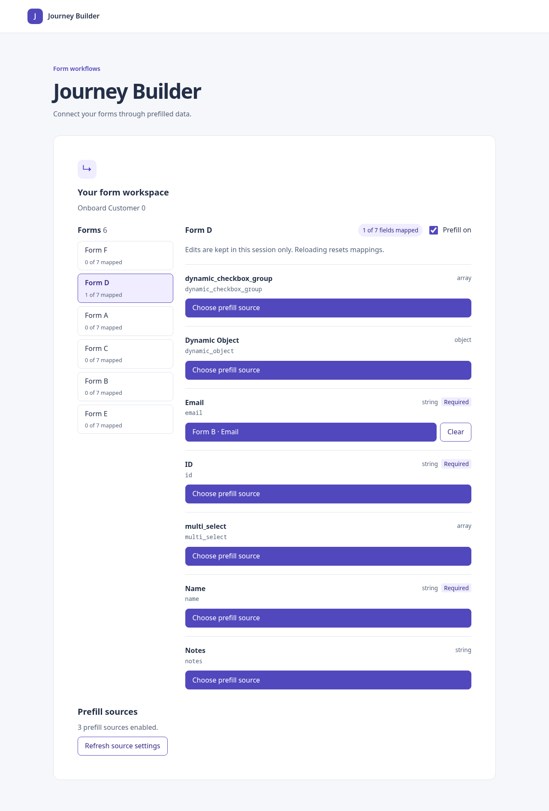
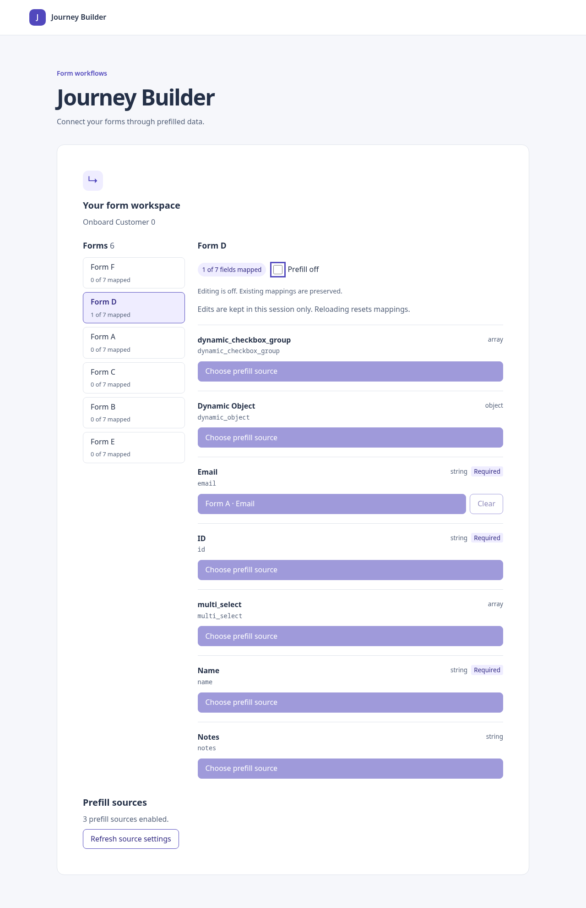
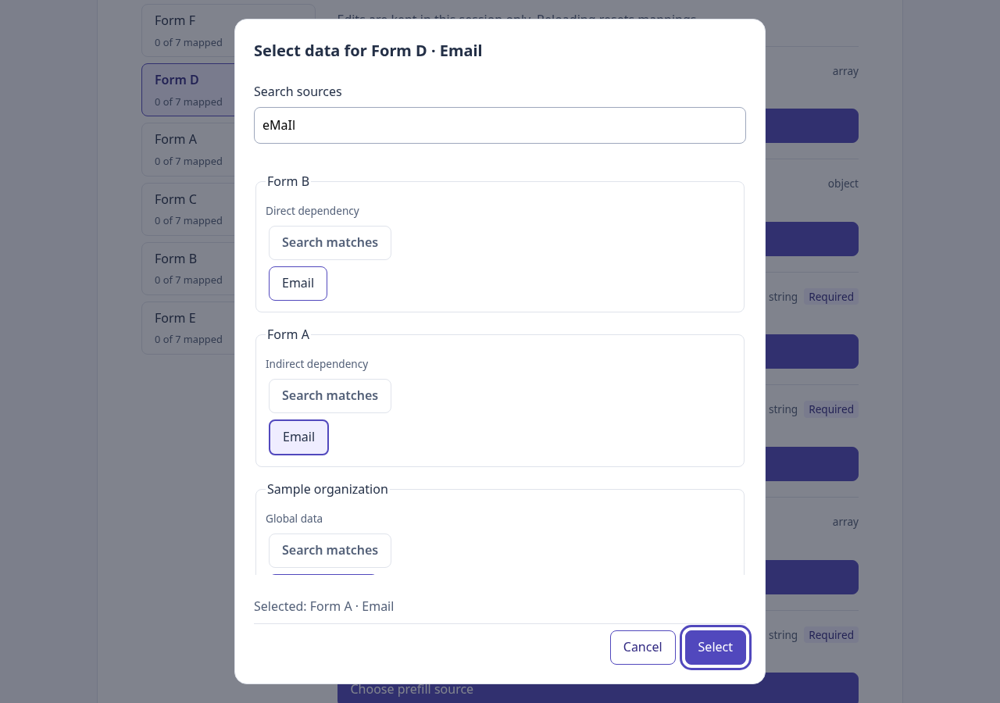
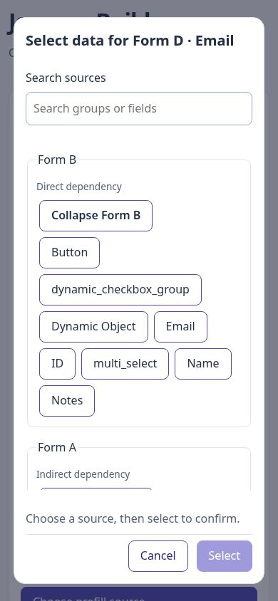

# Phase 10 — Editor polish and keyboard flow

## Outcome

The form list and selected-form header show mapped-field counts. A per-form prefill switch disables editing while preserving mappings. Source groups identify direct dependencies, indirect dependencies, and global data using provider-supplied descriptions. Responsive controls, wrapping labels, and a scrolling source list keep the editor usable on narrow screens.

This phase starts from main after PR #8 merged. No dependency or API changes were introduced.

## Architecture for someone learning React

```text
src/mappings/summarizeMappings.ts       derive counts from blueprint + mappings
src/mappings/summarizeMappings.test.ts  count correctness and identity tests
src/ui/PrefillEditor.tsx                own per-form editing switches; derive counts
src/ui/FormBrowser.tsx                 pass counts to the navigation component
src/ui/FormList.tsx                    display each form's mapped count
src/ui/FormFields.tsx                  compose the selected-form header and fields
src/ui/MappingControls.tsx             disable edits and preserve clear-action focus
src/sources/model.ts                   optional group description contract
src/sources/providers/                 supply descriptive group labels
src/ui/SourceGroupChoices.tsx          render descriptions without provider branching
src/index.css                         responsive layout, wrapping, touch controls
```

### What loads first?

The existing render flow remains:

```text
index.html → main.tsx → App
  → BlueprintConnection → PrefillEditor
      → summarizeMappings(blueprint, mappingState)
      → FormBrowser → FormList (counts)
                    → FormFields (header, switch, field rows)
      → SourceDialog → SourceGroupChoices (provider descriptions)
```

App still owns runtime source configuration. The existing blueprint loader still normalizes data and creates the dependency index before rendering the editor. This phase changes presentation and local editor state, not those loading boundaries.

### Counts are derived data

A mapping count can be calculated from existing mappings, so it does not need a separate `useState`. `summarizeMappings` counts only fields currently present in the blueprint and allowed by the target-field policy. It includes object/array fields and excludes buttons, stale fields, removed nodes, and other blueprint IDs. Form node IDs keep instances sharing one definition separate.

`PrefillEditor` uses `useMemo` to avoid recalculating while only unrelated local state changes. A reducer update changes mapping state, so the count is recalculated and React renders the new number. Replacing a source remains one mapped field; clearing decreases the count. Unavailable references still count as saved mappings, not as verified available sources.

The form button keeps its form name as its accessible name. Its count is linked with `aria-describedby`, so keyboard/screen-reader users can hear the count without making selection labels ambiguous. The selected-form header displays the same derived count.

### The switch is local editing state

The reference screenshot includes a toggle but does not define backend semantics. Here the switch is explicitly an editor behavior: off means assignment, replacement, and clearing are disabled for that form. Existing mappings are retained. Turning it on restores editing.

The editor stores disabled forms in a Set keyed by encoded blueprint ID and node ID. Toggling copies the Set instead of mutating the previous React state. Closing any open draft prevents an obsolete selection from being committed after editing is disabled. Switching forms preserves each form's toggle independently. Unmount/reload resets toggles and mappings because both are session-only.

The checkbox uses `role="switch"`, an accessible form-specific label, and native Space-key behavior. The UI states that editing is off and mappings are preserved. This does not implement backend prefill execution or a server-side enable flag.

### Composition and source descriptions

`FormFields` accepts a header slot, allowing the editor to supply counts and a switch while the read-only browser remains reusable. `FormBrowser` and `FormList` accept optional count data. They do not inspect the mapping reducer themselves.

`SourceGroup.description` is optional. Built-in providers return “Direct dependency”, “Indirect dependency”, or “Global data”. The UI simply renders the description. A new provider can supply its own description without adding a provider-ID condition to the dialog. During search, the disabled expansion control now reads “Search matches”, making the temporary expansion policy clearer.

## Keyboard and responsive improvements

- Form navigation remains ordinary buttons, with visible selection and counts.
- Clear returns focus to the remaining edit button. If configuration has disabled that button, focus moves to the field region rather than disappearing when Clear unmounts.
- Native dialog focus containment, Escape, and replacement focus return remain intact. The search input participates in Tab handling; hidden options do not.
- Narrow-screen form navigation uses two columns, while the detail view stays below it.
- Mapping controls and source choices wrap; primary actions have a minimum 44px height.
- The dialog source list scrolls independently so confirmation controls remain visible in the tested viewports. Outer scrolling remains a fallback for unusually short windows.

## Validation evidence

- `npm run test:run`: **297 tests passed across 18 files**, including **11 new tests**.
- `npm run typecheck`: passed (also executed by the production build).
- `npm run build`: passed, including the final scrolling adjustment.
- `git diff --check`: passed.

New tests cover count policy, shared definitions, other blueprint IDs, obsolete fields/nodes, empty forms, unavailable references, replacement/clear counts, accessible navigation descriptions, keyboard toggle preservation, per-form toggle independence, disabling an open draft, clear focus during configuration failure, and generic provider descriptions. Existing search, asynchronous lifecycle, mapping, graph, and configuration suites passed.

### Browser evidence

Executed `node /tmp/phase10-browser.cjs`, using the existing local Playwright/Chrome installation and production-built assets. The existing local mock server was reused read-only; graph/configuration used real HTTP, without interception. The graph request returned 200 and no page errors occurred.

Verified:

1. Map D.email from A; the detail count becomes 1 of 7.
2. Focus the prefill switch and press Space: mapping and count remain, editing buttons disable. Press Space again: editing resumes with the same mapping.
3. Navigate away/back, cancel a replacement, confirm replacement from B, and clear.
4. Search with no results; Tab from Cancel returns to the search input.
5. Dialog initial focus, containment, and trigger focus return remain correct.
6. At widths 320, 390, 768, and 1280 pixels, no horizontal document overflow was found; dialog bounds stayed inside the viewport. Cancel remained within the checked viewport after the scrolling adjustment.
7. Refreshing disabled source configuration still preserves and labels a mapping, which can be cleared while editing is enabled.

A narrow-screen screenshot review prompted the independent source-list scrolling adjustment; the final browser scenario was rerun successfully. These are automated keyboard/viewport observations plus screenshot inspection, not a human screen-reader or cross-browser audit. The harness is temporary local tooling, not yet a portable CI browser command.






## Remaining risks and deferrals

Mapping counts describe stored references, not provider availability. The editing switch has no backend execution semantics and is not persisted. Large catalogs still wait for all selected providers; per-field availability requests are not batched. Native dialog support is assumed. Cross-browser, screen-reader, and complete reproducible browser-suite acceptance remain outstanding. No deployment or CI success is claimed by local results.

## Next phase

Phase 11: complete app acceptance against the mock. Consolidate a small reproducible browser scenario covering the full mapping flow, source subsets, server failure/retry, keyboard use, narrow screens, and reload semantics. Record the mock revision and separate automated, browser, and remaining evidence.
