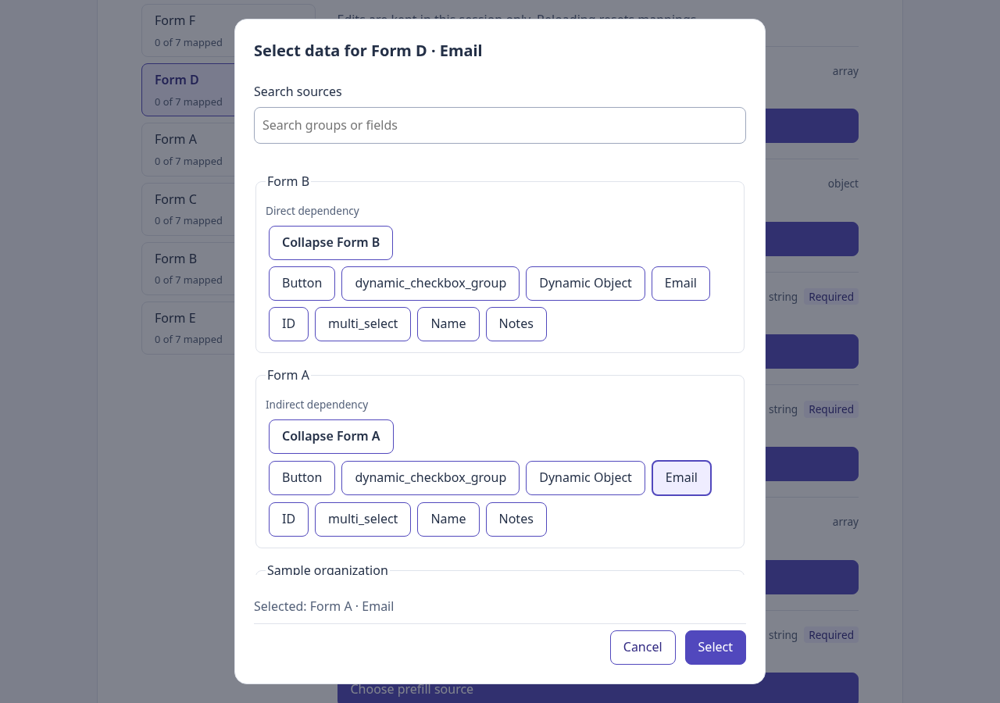
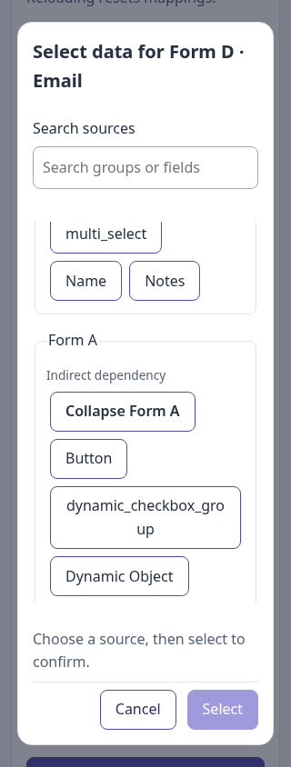

# Phase 11 — Reproducible application acceptance

## Outcome

The repository now contains an executable browser acceptance suite. It replaces reliance on temporary scripts, previously installed browser tooling, and an already-running local mock server. The suite builds this checkout, starts an isolated pinned mock, and drives the real application through HTTP using the Chromium version locked with Playwright.

Phase 10 PR #9 was still open at implementation start. This phase is stacked on `feat/phase-10-editor-polish`; merge Phase 10 before retargeting this PR to main. No merge is performed by this task.

## Files and architecture for React learners

```text
playwright.config.ts          browser runner, timeouts, reports, artifacts
 tsconfig.e2e.json            TypeScript checking for browser tests and tooling
 e2e/
   environment.ts            isolated mock, production build, HTTP server, cleanup
   fixtures.ts               worker/test setup and page-error checking
   journey.spec.ts           16 user-facing acceptance scenarios
   mock/
     index.cjs               pinned official mock server
     graph.json              pinned official graph
     upstream-package.json   upstream attribution/license metadata
     provenance.json         revision and verified SHA-256 checksums
     README.md               source and adaptation details
.github/workflows/validate.yml  automated validation and report upload
```

The package scripts, lockfile, gitignore, and Vitest test discovery were also updated. No React component or product behavior changes in this phase.

### What loads first?

For browser acceptance, the test runner starts before React:

```text
npm run test:e2e
  → application and test-tooling typechecks
  → Playwright configuration
  → worker fixture
      → verify pinned files
      → start isolated official mock on a free loopback port
      → build this checkout against that port
      → serve built files under /acceptance/ on another free port
  → fresh browser page for each scenario
      → index.html → main.tsx → App
          → configuration fetch + blueprint fetch
          → normal editor, providers, mapping reducer, and dialog
  → assertions and screenshots
  → close owned servers and remove temporary files
```

React loads the same production code a user would receive. These tests do not import components into a simulated document and do not intercept requests. They click and type in a real browser, asserting observable behavior.

### How this differs from existing tests

The 297 Vitest tests check graph logic, provider contracts, reducer behavior, hooks, and component interactions in detail. They are fast and can deliberately control promise timing. The 16 browser tests prove that these pieces work together with real HTTP, CORS, production assets, native dialog behavior, and viewport layout.

A passing browser scenario is not deployment proof, and a passing unit test is not native-browser proof. Both forms of evidence are retained.

### Why fixtures own the environment

The worker fixture builds once and owns its servers. Each test resets temporary graph/configuration files and gets a fresh browser context. One worker keeps mutable fixture data deterministic; retries are disabled so a flaky failure is not hidden by an automatic retry. Setup/teardown uses try/finally, and startup has a deadline.

Ports are assigned by the OS. No fixed application or mock port is assumed, and existing local listeners are untouched. The production build uses `/acceptance/` to verify runtime configuration works under a non-root deployment path. Configuration subset tests also compare JavaScript asset hashes before/after the JSON change, proving no rebuild is used to switch sources.

Fixture design follows [Playwright's fixture model](https://playwright.dev/docs/test-fixtures); UI assertions use its [retrying assertions](https://playwright.dev/docs/test-assertions) rather than arbitrary sleeps.

## Run it from a checkout

Use the project's required Node 22 version, then:

```sh
npm ci
npx playwright install chromium
npm run test:run
npm run build
npm run test:e2e
```

On a supported Linux host missing browser system libraries, use `npx playwright install --with-deps chromium` (may need administrator rights). CI uses that command on Ubuntu 24.04. No separate mock startup or `.env` setup is required for acceptance: its build overrides the public API URL/tenant/blueprint variables. It creates its build output outside the normal `dist` directory.

Reports:

```sh
npm run test:e2e:report
```

HTML reports are in `playwright-report/`; screenshots and failure traces are in `test-results/`. They are ignored by Git. Selected successful screenshots are attached to the report. GitHub Actions uploads reports/results with seven-day retention even if a check fails. Screenshot assertions are behavioral viewport checks, not pixel baselines.

## Mock provenance and actual failure behavior

Pinned upstream revision: `fdfbb9c78eb8ac518f952be183a3718098005265`.

Graph SHA-256: `bef74daa5b072ccbbe408eb3b79f5377168c84c661d662a6f9812bb68dd1d19c`.

The route implementation is unchanged. Only the temporary copy's listen call changes to bind loopback on an available port and report readiness over IPC. A direct HTTP response must byte-match the pinned graph and include the official success CORS header.

The official mock's error path returns HTTP 500 without CORS headers. The acceptance test deletes only its temporary graph file, confirms HTTP 500 using the test request client, and verifies that the actual browser displays the connection-error message caused by CORS. Restoring the file and pressing Retry recovers. The suite does not invent a CORS-enabled 500 response or modify application error handling to satisfy the test.

## Acceptance coverage

1. Real graph HTTP response/checksum, six forms, D.email from A, navigation persistence, replacement cancellation, replacement from B, clear, mapped count, and focus return.
2. Native dialog modality/background focus protection, Tab/Shift+Tab with no matches, Escape, Enter confirmation, Space toggle preservation, and reload reset.
3. All eight combinations of direct, indirect, and global providers, including none, checked in the real dialog without JavaScript changes.
4. Invalid configuration, settings refresh, preserved unavailable mappings, clearing, and recovery to a valid subset.
5. Actual mock HTTP failure and retry recovery.
6. Invalid graph data blocking forms and recovery after correction.
7. Search/expansion and dialog/action bounds at 320, 390, and 768 pixels, alongside desktop flows at 1280 pixels.

Every scenario fails on an unexpected browser JavaScript page error. Expected network errors in the deliberate server-failure test are not misrepresented as JavaScript exceptions.

## Validation evidence

- `npm run test:run`: **297 tests passed across 18 files**.
- `npm run build`: passed, including application typecheck.
- `npm run typecheck:e2e`: passed.
- `npm run test:e2e`: **16 Chromium tests passed**; all real HTTP, no request interception.
- Clean `npm ci` followed by the same acceptance command: **passed again, 16/16 browser tests**.
- `git diff --check`: passed.

The initial browser-runner attempt found a Node ESM JSON import-attribute requirement before any scenarios ran. The explicit import attribute was added; subsequent acceptance runs passed. Local Playwright installation reported use of its Ubuntu fallback build on this host; the locked browser ran successfully. CI uses the supported Ubuntu image.

CI is configured by this PR; its actual run status is separate from local evidence and should be checked on the PR. No deployment or submission is performed.




## Remaining risks and next phase

Browser coverage currently targets Chromium only. Firefox/WebKit and human screen-reader review are not included. The official mock has no persistence route; reload intentionally resets mappings and toggles. Remote-provider latency/failure timing remains primarily covered by deterministic hook/component tests. The runner needs loopback binding, browser system dependencies, and one-time package/browser installation access.

Phase 12 finishes setup/architecture/extension documentation, a runnable new-provider example, clean-checkout handoff instructions, limitations, and a short demonstration guide.
